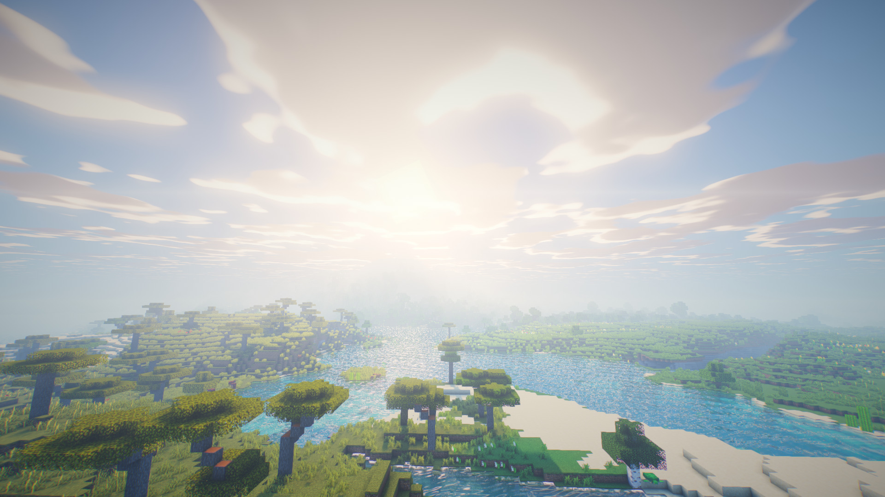
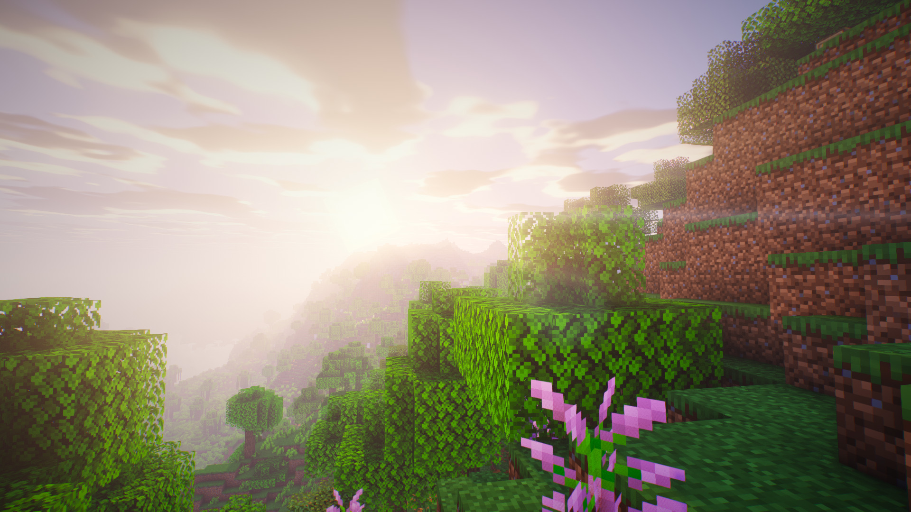
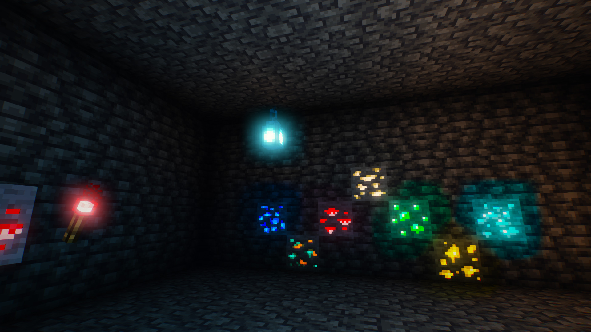
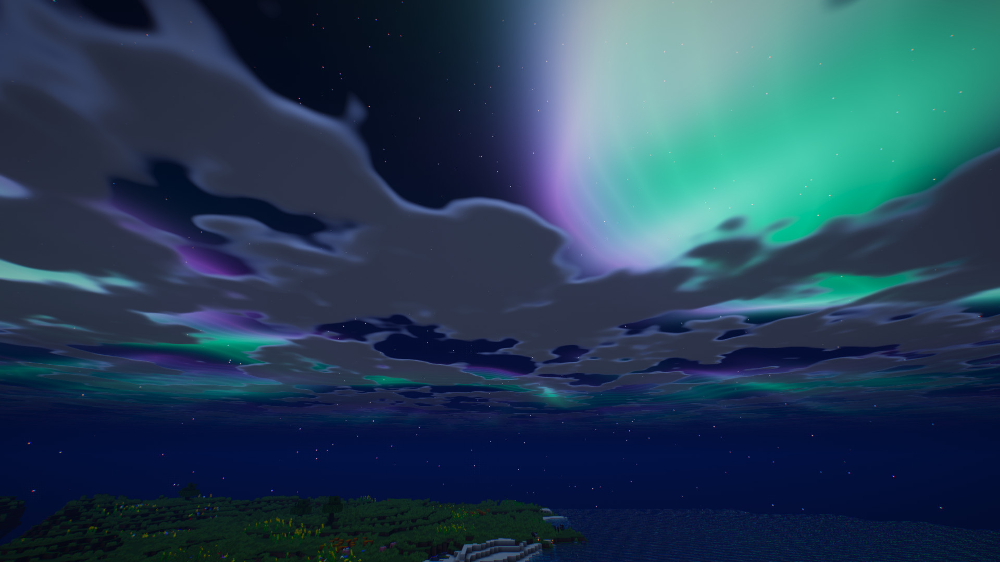

<p align="center"></p>

# Aurora Dreams

A dreamy, cinematic shader pack for Minecraft (Java Edition) built for **Iris** and **OptiFine**.

## Screenshots






## Features
- **Night-sky aurora borealis** with procedural stars, moon glow and twinkling
- Dynamic sky: deep-blue day gradient, rose/orange sunrise and sunset, rain overcast
- **Soft, distortion-mapped shadows** (sun and moonlight) with normal-offset bias
- **Screen-space ambient occlusion**
- **Water** with animated waves, Fresnel reflections, **screen-space reflections**, sky + aurora reflections and sun glints
- Waving grass, flowers, crops and leaves
- Warm flickering torchlight
- Atmospheric haze and distance fog tinted by the sky; underwater fog
- **Bloom**, ACES tonemapping, cool-shadow / warm-highlight grading, vignette, subtle chromatic aberration and grain
- Simple Nether and End looks
- Coloured light spreading: redstone torches tint their surroundings red, soul fire blue, ores glow and light the cave in their own colour
- Stained-glass coloured shadows, lens flare, wet surfaces in rain
- Presets: Performance / Balanced / Ultra, plus sliders for everything in the options screen

## Install
1. Install [Iris](https://irisshaders.dev) (recommended) or OptiFine.
2. Drop `AuroraDreams-<version>.zip` into your `shaderpacks` folder (do **not** unzip it).
3. In game: Options > Video Settings > Shader Packs > Aurora Dreams.

Tip: nights are best seen with clear weather and a clear view of the sky.

## Compatibility
- Minecraft 1.17+ with Iris or OptiFine (GLSL 1.20, `#include` support required).
- Water is flagged by the block id `10002`, foliage by `10000`/`10001` in `block.properties`.
- Tested for GLSL compile-correctness with Khronos `glslang`; visual tuning is ongoing - issues and screenshots are welcome.

## Building the zip
```
python build.py
```

## License
MIT - see [LICENSE](LICENSE).
